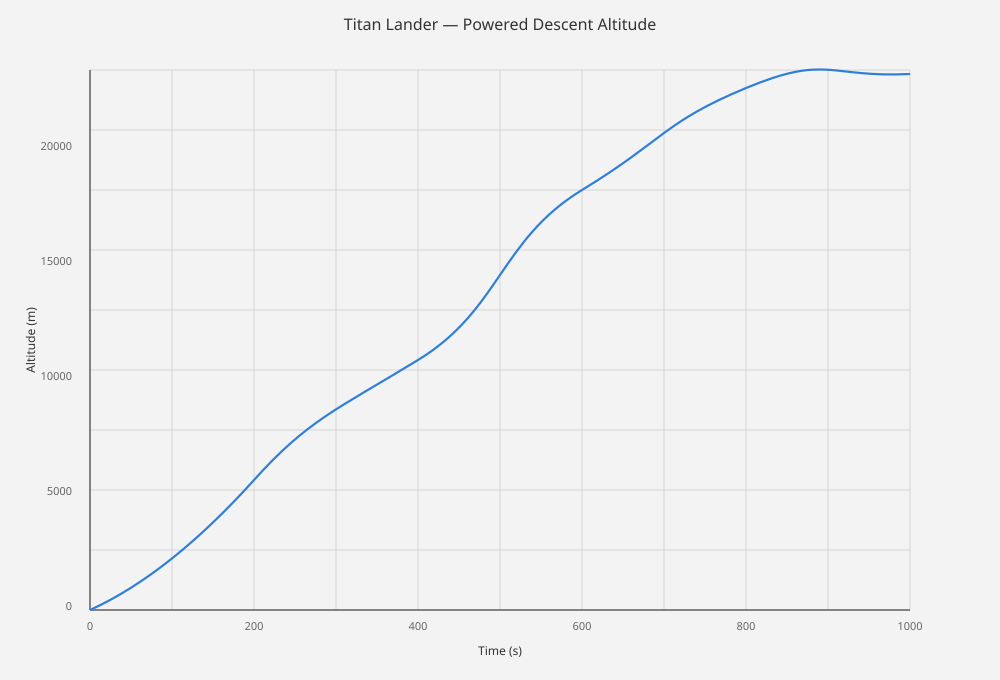
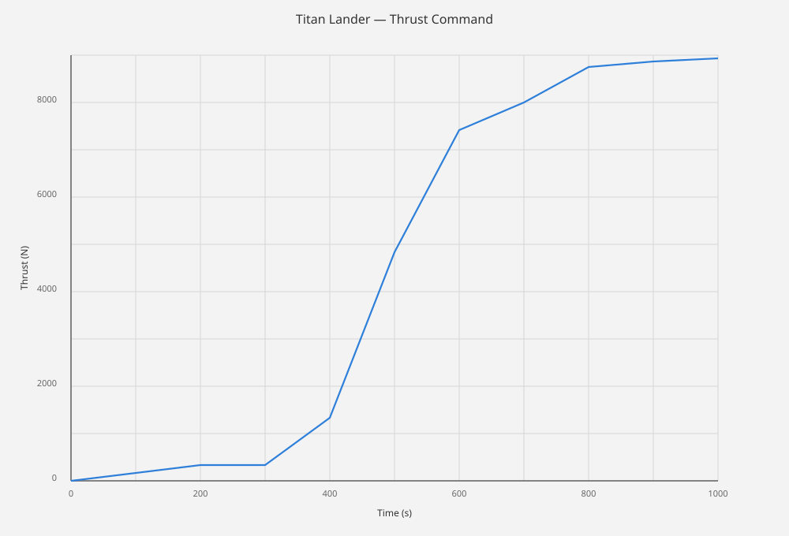
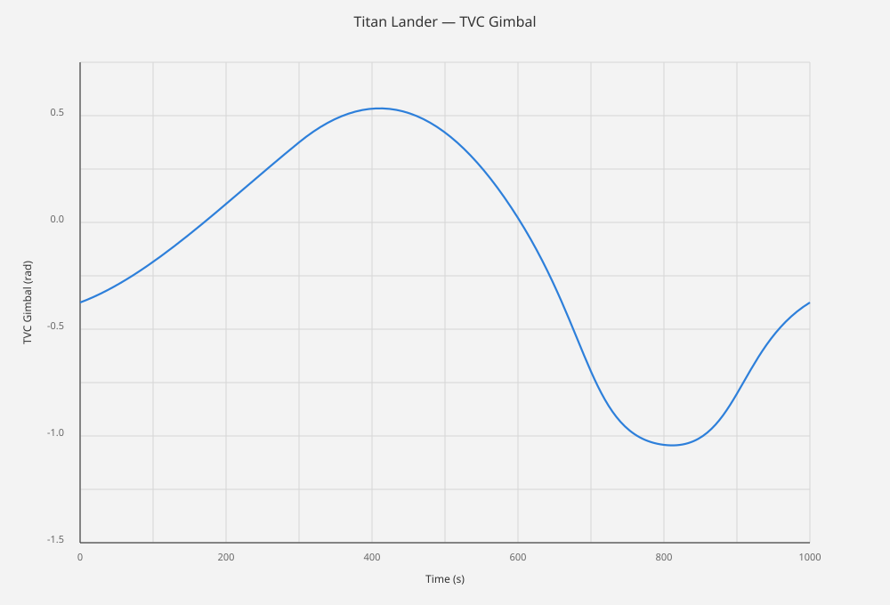
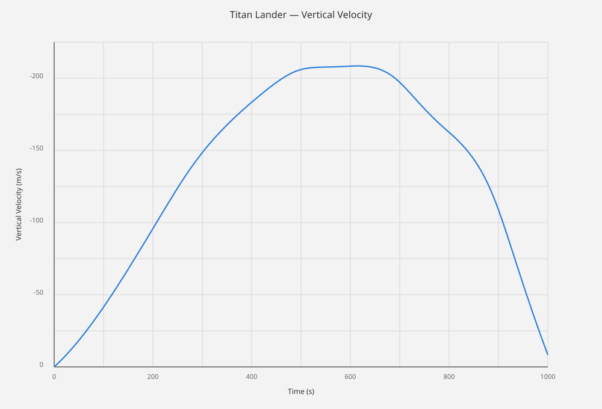
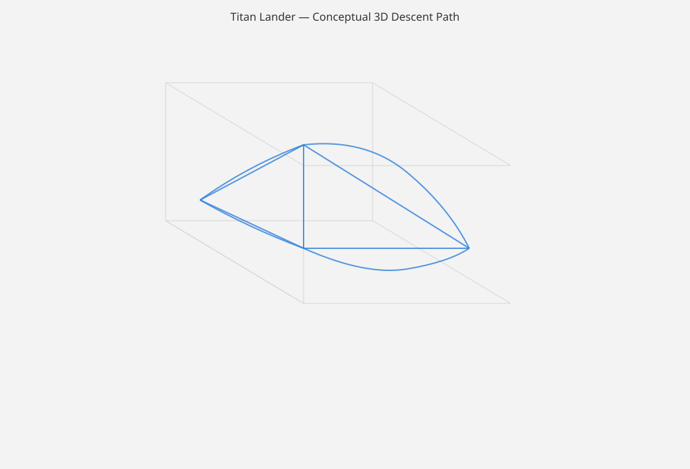

# Titan-GNC-TVC

MATLAB simulation of a powered descent lander for Titan with GNC and TVC control.

## Overview

This repository models a powered descent and landing scenario for Titan using a simplified guidance, navigation, and control architecture. The simulation includes altitude tracking, thrust modulation, TVC steering, vertical-rate control, and a conceptual 3D descent trajectory.

## MATLAB Files

- `Titan_GNC_TVC.m` — main simulation script
- `launcher.m` — convenience runner that executes the main simulation

## Simulation Output Figures

### Powered descent altitude



### Thrust command



### TVC gimbal



### Vertical velocity



### Conceptual 3D descent path



## Repository Structure

```text
Titan-GNC-TVC/
├── README.md
├── Titan_GNC_TVC.m
├── launcher.m
├── figures/
│   ├── titan_lander_powered_descent_altitude.svg
│   ├── titan_lander_thrust_command.svg
│   ├── titan_lander_tvc_gimbal.svg
│   ├── titan_lander_vertical_velocity.svg
│   └── titan_lander_3d_descent_path.svg
└── main simulation files
```
